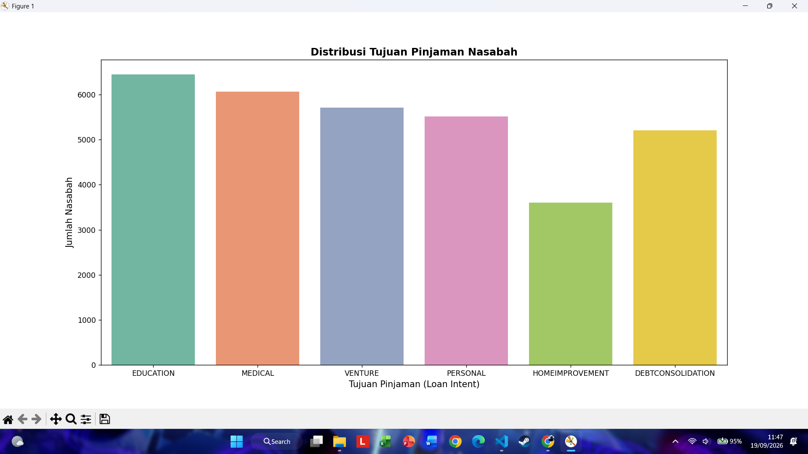
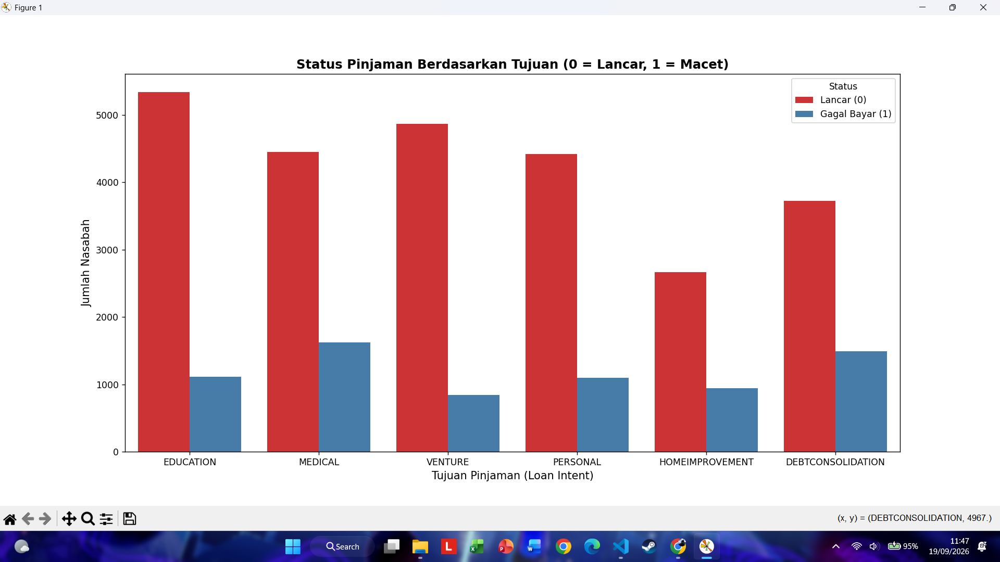
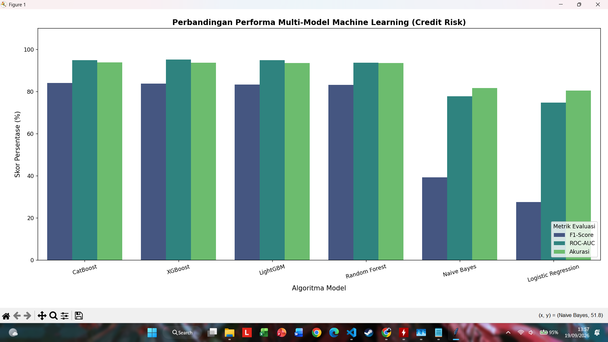
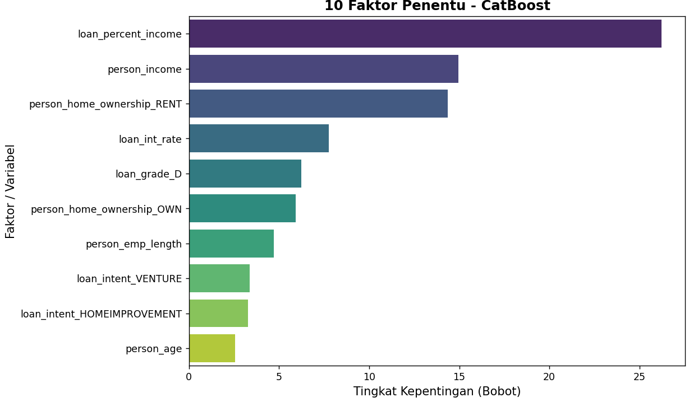

# 🏦 **CREDIT RISK CLASSIFICATION**
**End-to-End Data Pipeline & Multi-Model Machine Learning Benchmarking using Python**

## 📌 **Background & Business Objectives**
In the banking industry, identifying prospective customers who are at risk of default (*default*). It's crucial to minimize status *Non-Performing Loan* (NPL). This project develops a comparative credit risk prediction system based on machine learning, which classifies customers into categories of **Current (0)** or **Default (1)** based on their historical profiles, financial data and loan purposes.

## 📈 **Exploratory Data Analysis (EDA)**
Before building a predictive model, an initial analysis is conducted to understand the characteristics and distribution of customer data based on the purpose of the loan (*loan intent*).

### **1. Distribution of Customer Loan Purposes**
The chart below shows the distribution of applicant volume based on the reason or purpose for the loan application:



*   **Volume Insights:** The **EDUCATION** and **MEDICAL** categories account for the highest number of loan applications from the total client base, followed by the *Venture* and *Debt Consolidation* categories.

### **2. Loan Status by Purpose (Current vs. Default)**
To examine the initial correlation with credit risk, each loan purpose category is broken down based on payment status (0 = Current, 1 = Default):



*   **Business Risk Insights:** It is evident that the **MEDICAL** and **DEBTCONSOLIDATION** categories have a relatively higher proportion of blue bars (Default/1) in relation to their total volume, indicating that loans for medical purposes and debt consolidation carry a greater risk of default. Conversely, the **VENTURE** category shows a relatively safer risk profile.

## 🗄️ **Exploratory Data Analysis & Risk Profiling via SQL**

Prior to the predictive modeling phase in Python, initial analysis and data integrity validation are performed directly from the relational database using SQLite (`credit_risk_database.db`).

### **Main SQL Query:**
1. **Loan Default Rate Portfolio Analysis:**
   ```sql
   SELECT 
       loan_status,
       COUNT(*) AS total_nasabah,
       ROUND(COUNT(*) * 100.0 / (SELECT COUNT(*) FROM credit_risk_bersih), 2) AS persentase
   FROM credit_risk_bersih
   GROUP BY loan_status;
   ```
2. **Risk Mapping Based on Loan Purpose (loan_intent):**
   ```sql
   SELECT 
    loan_intent AS tujuan_pinjaman,
    COUNT(*) AS total_nasabah,
    SUM(loan_status) AS total_gagal_bayar,
    ROUND(AVG(loan_status) * 100.0, 2) AS default_rate_persen,
    ROUND(AVG(loan_amnt), 2) AS rata_rata_nominal_pinjaman
   FROM credit_risk_bersih
   GROUP BY loan_intent
   ORDER BY default_rate_persen DESC;
   ```
3. **Validation of the Risk-Based Pricing Principle (loan_grade):**
   ```sql
   SELECT 
    loan_grade AS peringkat_kredit,
    COUNT(*) AS total_nasabah,
    SUM(loan_status) AS total_gagal_bayar,
    ROUND(AVG(loan_status) * 100.0, 2) AS default_rate_persen,
    ROUND(AVG(loan_int_rate), 2) AS rata_rata_suku_bunga
   FROM credit_risk_bersih
   GROUP BY loan_grade
   ORDER BY loan_grade ASC;
   ```
   
Based on the Business Insights Obtained:

### **1. Risk Profile Based on Loan Purpose (`loan_intent`)**
An SQL query is executed to map loan categories with the highest default rates:

| **Loan Purpose** | **Total Customers** | **Total Failure to Pay** | **Default Rate (%)** | **Average Loan ($)** |
| :--- | :---: | :---: | :---: | :---: |
| **DEBTCONSOLIDATION** | 5.212 | 1.490 | **28,59%** | $9.594,89 |
| **MEDICAL** | 6.070 | 1.621 | **26,71%** | $9.260,04 |
| **HOMEIMPROVEMENT** | 3.605 | 941 | **26,10%** | $10.360,52 |
| **PERSONAL** | 5.518 | 1.097 | **19,88%** | $9.569,92 |
| **EDUCATION** | 6.451 | 1.111 | **17,22%** | $9.481,53 |
| **VENTURE** | 5.716 | 847 | **14,82%** | $9.580,97 |

### **2. Validation of the *Risk-Based Pricing* Principle (`loan_grade`)**
An SQL query is executed to examine the relationship between credit quality ratings, interest rates and the potential for default:

| **Grade** | **Total Customers** | **Total Failure to Pay** | **Default Rate (%)** | **Average Interest Rate (%)** |
| :---: | :---: | :---: | :---: | :---: |
| **A** | 10.775 | 1.073 | **9,96%** | 7,67% |
| **B** | 10.448 | 1.701 | **16,28%** | 10,99% |
| **C** | 6.455 | 1.339 | **20,74%** | 13,22% |
| **D** | 3.625 | 2.140 | **59,03%** | 14,99% |
| **E** | 964 | 621 | **64,42%** | 16,49% |
| **F** | 241 | 170 | **70,54%** | 17,76% |
| **G** | 64 | 63 | **98,44%** | 19,53% |

### 💡 **Main Business Insight:**
* Highest-Risk Loan Purposes: Category `DEBTCONSOLIDATION` (28,59%) and `MEDICAL` (26,71%) has the highest default rate, indicating that debtors in this category are under precarious financial pressure.
* The Tipping Point: There has been a drastic surge in the non-performing loan rate for Grade C (20,74%) to Grade D (59,03%). More than half of customers in Grade D and below are found to be in default, justifying why banks charge much higher interest rates in this segment.

### 💡 **Why Choose Machine Learning Over Traditional Methods?**
Although traditional models (such as Logistic Regression) are simpler, they often fail to capture complex patterns in financial data. This project employs **Machine Learning (specifically Gradient Boosting)** due to its clear superiority:
*   Non-Linear Patterns: Capable of mapping hidden interactions between variables that are too rigid to be captured by standard statistical formulas.
*   Minimize Risk: Far more effective at accurately detecting delinquent customers and preventing financial losses for the bank.
*   Data Objectivity: The algorithm independently formulates the optimal decision rules based on the weighting of real-world data via Feature Importance.

## 🗄️ **Dataset & Preprocessing**
*   Source: Credit Risk Dataset
*   Initial Data Dimensions: 32,572 rows and 12 feature columns.
*   Dimensions After Encoding: 32,572 rows and 23 columns (after applying One-Hot Encoding).
*   Data Splitting: An 80% training data (26,057 rows) and 20% test data (6,515 rows) split.

## 🛠️ **Benchmarking Methodology & Models**
This project tests and compares **6 different machine learning algorithms** in parallel to identify the most optimal predictive solution for financial institutions:
1. Logistic Regression (LR)
2. Naive Bayes(NB)
3. Random Forest (RF)
4. XGBoost
5. LightGBM
6. CatBoost

## 📊 **Model Performance Comparison Results**
The following is a summary table of the performance of the six models tested on the test data (6,515 rows):

| Model | Accuracy (%) | Precision (%) | Recall (%) | F1-Score (%) | ROC-AUC (%) |
| :--- | :---: | :---: | :---: | :---: | :---: |
| **CatBoost** | **93.81** | **96.63** | 74.33 | **84.03** | 94.85 |
| **XGBoost** | 93.63 | 94.85 | **74.96** | 83.74 | **95.21** |
| **LightGBM** | 93.55 | 96.32 | 73.35 | 83.28 | 94.90 |
| **Random Forest** | 93.48 | 95.54 | 73.63 | 83.17 | 93.62 |
| **Naive Bayes** | 81.61 | 70.88 | 27.14 | 39.25 | 77.68 |
| **Logistic Regression** | 80.37 | 71.68 | 17.04 | 27.54 | 74.69 |

### 📈 **Multi-Model Comparison Chart**


## 🔍 **In-depth Analysis & Business Insights**
Below's the breakdown and explanation:
*   **The Dominance of Gradient Boosting Algorithms:** Boosting-based models (**CatBoost, XGBoost, and LightGBM**) have proven to be significantly superior to traditional models. This is because their architecture is capable of mapping complex, non-linear interactions within financial data..
*   **Best Production Model Machine Learning:** **CatBoost** was identified as the best-performing model, achieving an **F1-Score of 84.03%**, offering an optimal balance between detecting delinquent customers and minimizing the rate of incorrect classifications (*False Positives*).
*   **Limitations of the Linear Model:** Traditional models such as Logistic Regression and Naive Bayes perform poorly in terms of the *Recall* metric, as the majority of delinquent customers go undetected (resulting in a high number of *False Negatives*).

### 🏆 **Determinants of Non-Performing Loans**


Based on the best model analysis, the three primary triggers for non-performing loans are:
1.  **Loan to Income Ratio:** The most definitive warning sign, debt repayments that consume an excessively large portion of one’s monthly salary drastically increase the risk of default.
2.  **Person Income:** Indicates the client's absolute financial capacity.
3.  **Person Home Ownership RENT:** Customer profiles with a rental/contractual status exhibit a distinct pattern of financial risk.

## 💻 **Tech Stack**
* **Programming & Query Languages:** Python 3, SQL
* **Databases & Tools:** SQLite and DB Browser for SQLite
* **Analytical Library:** Pandas and NumPy
* **Machine Learning Libraries:** Scikit-Learn, XGBoost, LightGBM, CatBoost
* **Visualization Libraries:** Matplotlib and Seaborn
